# Ticket workspace implementation

This ledger maps the 151 recommendations from the audit of `f745763` onto the application at `2e0f6c7` and the changes in this branch. The [interactive audit](../../ui-ux-results/ticket-workspace-audit.html) contains the original comparisons and filters. The original audit predates named accounts, invitation links and Ticket conversations. The direct creation form remains the default. Customers can opt into the guide.

The customer queue index is additive. Existing rows keep the compatibility read until their group is present. An operator can later call the internal `customer_queue_migration:backfill` with its returned cursor until `isDone`. Each call handles at most 25 Tickets. Browser validation uses disposable fixtures. For a staggered deployment, publish the compatible Convex functions and schema before serving the client that sends explicit answer intent.

## Measured workflows

The images on the left come from the original audit fixture. The images on the right come from Chromium on the updated application with local synthetic Tickets. Ticket contents, data volumes and account features differ between these revisions. The camera comparison shows the additional approval step after capture.

| Surface | Original application | Implemented workflow |
| --- | --- | --- |
| Staff workspace at 390px | 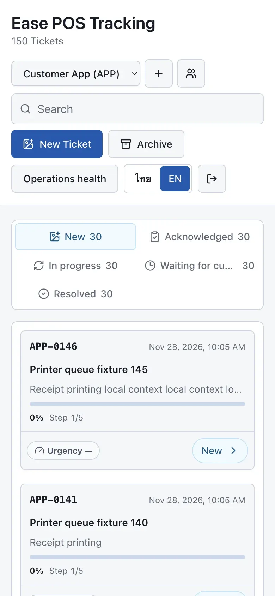 | 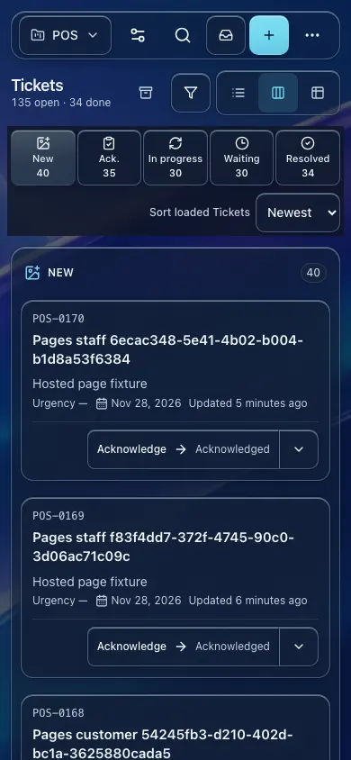 |
| Customer workspace at 390px | 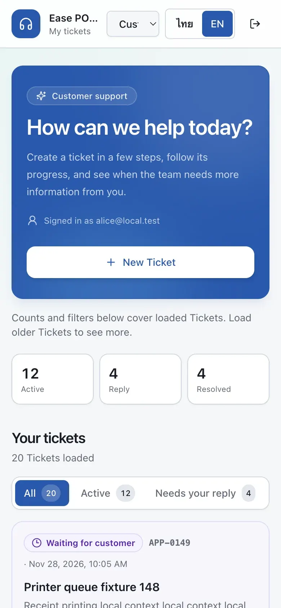 | 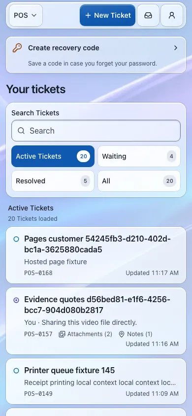 |
| Staff board at 1100px | 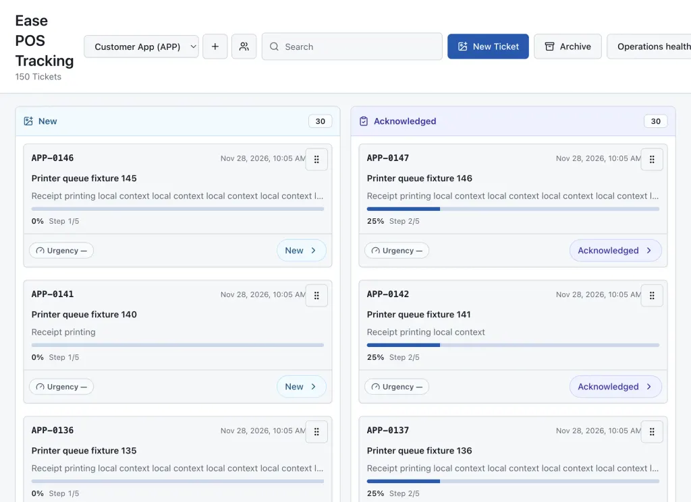 | 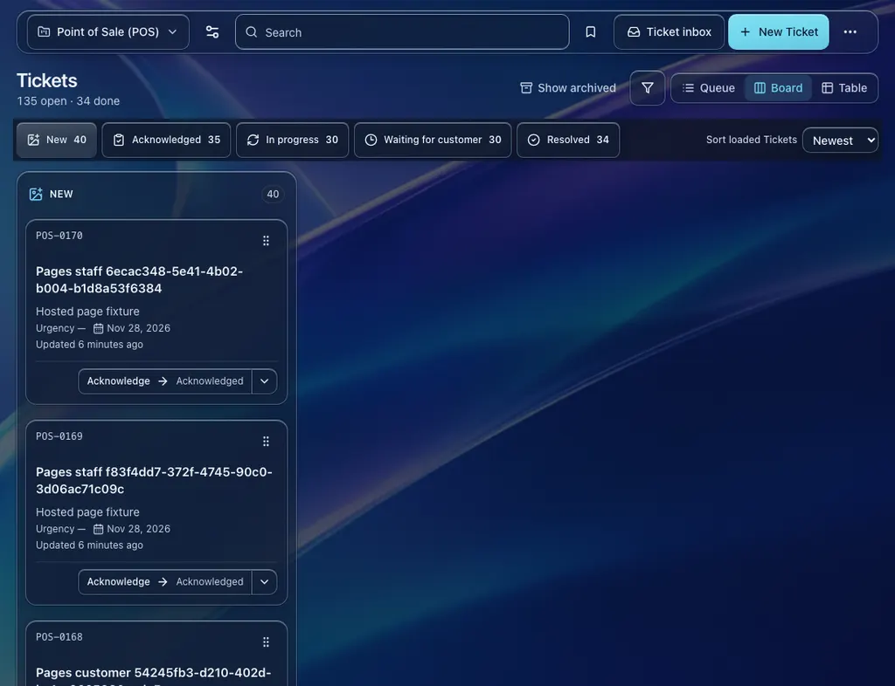 |
| Customer Ticket creation at 390px | 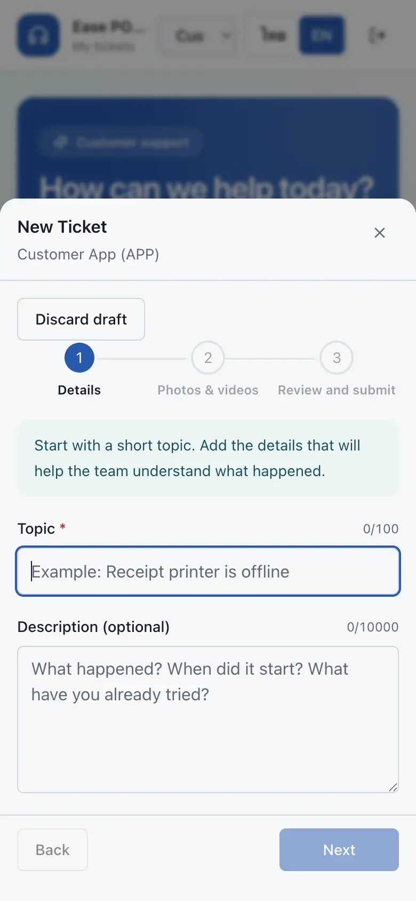 | 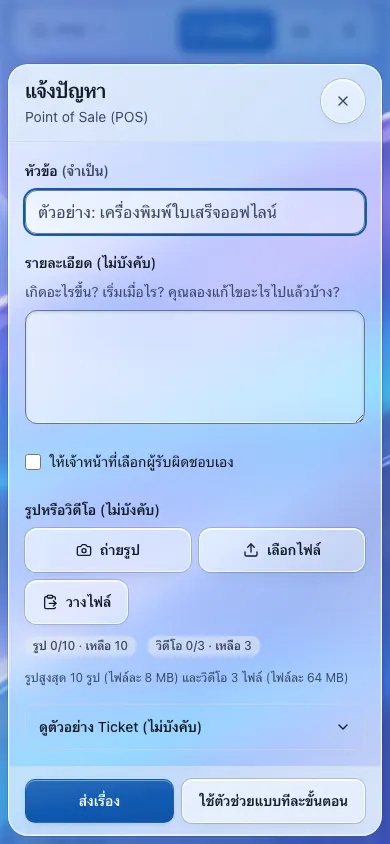 |
| Camera | 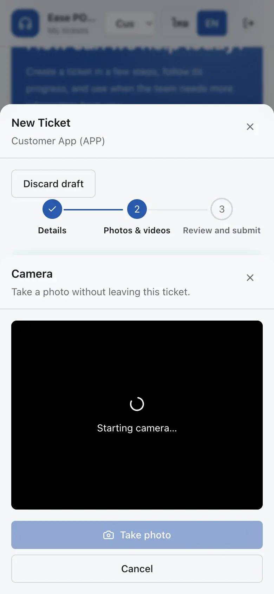 | 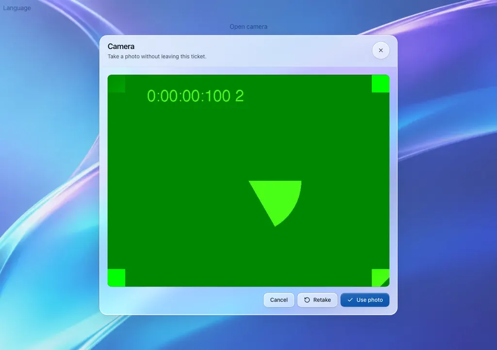 |

At 390px both signed-in toolbars measured **54px**. Every visible toolbar control measured at least **44 × 44px**. At 1100px the staff board had one selectable lane and zero horizontal document overflow. At 1280px it displayed five lanes. Customer and staff phone journeys opened three Tickets in three activations. These measurements used synthetic data in Chromium.

| Media recovery | Keyboard and magnification |
| --- | --- |
| 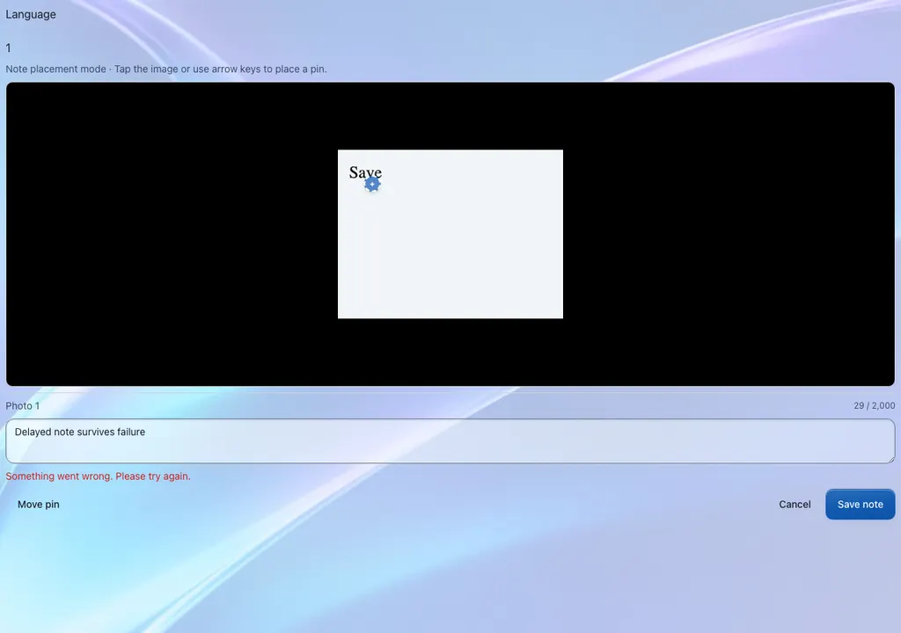 | 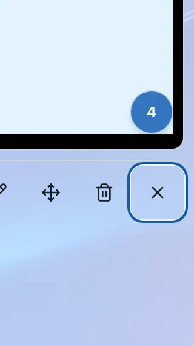 |
| 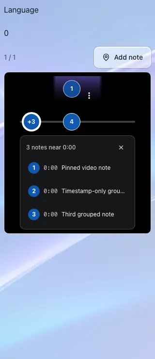 | A grouped timestamp returned focus to its originating control. At 320px, each of four corner notes could be opened by keyboard at both 100% and 200% zoom. |

## Staff workspace and triage

| ID | Audited change | Delivery | Entry point |
| --- | --- | --- | --- |
| UX-001 | Keep the mobile lane switcher within reach | The pinned selector keeps all five lane counts within reach. Arrow, Home and End keys change lanes and preserve keyboard focus. | [staff-board.tsx](../../src/components/staff-board.tsx) |
| UX-002 | Keep status tabs through 1279 px | The board renders one full-width lane through 1279px and all five lanes from 1280px. Keyboard navigation and touch swiping work in the single-lane layout. | [staff-board.tsx](../../src/components/staff-board.tsx) |
| UX-003 | Offer every destination on each Ticket | Move to, then In progress: two activations, no dialog, board stays in place. | [staff-board.tsx](../../src/components/staff-board.tsx) |
| UX-004 | Name the next status on the action | One current-state label and one visible destination for each advance. | [staff-board.tsx](../../src/components/staff-board.tsx) |
| UX-005 | Sort loaded Tickets by urgency | Highest score first, unscored last, lower number wins a tie (POS-0042 above POS-0043). The control is labelled as applying to loaded Tickets. | [staff-board.tsx](../../src/components/staff-board.tsx) |
| UX-006 | Show when a Ticket move is saving | No enabled move control on a Ticket whose move is pending. Other Tickets stay available. | [staff-board.tsx](../../src/components/staff-board.tsx) |
| UX-007 | Label empty lanes as drop destinations | One named drop instruction per valid empty target during drag. one idle message otherwise. | [staff-board.tsx](../../src/components/staff-board.tsx) |
| UX-008 | Clear arrival markers when Tickets are opened | Opening a Ticket clears its marker. A new batch is announced once, without recounting arrivals already announced. | [staff-board.tsx](../../src/components/staff-board.tsx) |
| UX-009 | Show loaded and total lane counts | Shows "20 of 40" before activation and a distinct loading label while fetching. | [staff-board.tsx](../../src/components/staff-board.tsx) |
| UX-010 | Add Home and End to status tabs | Each key press focuses and selects its target immediately. | [staff-board.tsx](../../src/components/staff-board.tsx) |
| UX-011 | Announce keyboard drag targets | Each keyboard destination change announces the target status in the active language. | [staff-board.tsx](../../src/components/staff-board.tsx) |
| UX-012 | Show when each Ticket was last updated | One last-update time on each item, calculated from `updatedAt`. | [ticket-card.tsx](../../src/components/ticket-card.tsx) |
| UX-013 | Use one control to open Ticket details | One detail-opening focus stop. one visible file count. The media section is still reachable from the open Ticket. | [ticket-card.tsx](../../src/components/ticket-card.tsx) |
| UX-014 | Read the note count with its unit | Each nonzero count has one explicit localized unit. | [ticket-card.tsx](../../src/components/ticket-card.tsx) |
| UX-015 | Write urgency bands alongside scores | Every Ticket shows its band in text, including Unscored. | [ticket-card.tsx](../../src/components/ticket-card.tsx) |
| UX-016 | Show two lines of the Ticket excerpt | The row shows at most two description lines. The full text stays available in Ticket detail. | [ticket-card.tsx](../../src/components/ticket-card.tsx) |
| UX-017 | Show each search result's status | One read-only status per search result, already on main. | [ticket-card.tsx](../../src/components/ticket-card.tsx) |
| UX-018 | Label search and add a clear control | One persistent label, and one activation to clear the search and keep focus. The placeholder stays "Search" for the existing browser tests. | [ticket-explorer.tsx](../../src/components/ticket-explorer.tsx) |
| UX-019 | Move search rules behind disclosure | No rules text before the count when matches exist. empty results show the tips. | [ticket-explorer.tsx](../../src/components/ticket-explorer.tsx) |
| UX-020 | Preserve and label staff search scope | Typed staff searches use an opaque entry identifier and mount-scoped memory. Copy search link explicitly includes the authorized Project, query and archive scope. | [use-workspace-navigation.ts](../../src/features/tickets/use-workspace-navigation.ts) |
| UX-021 | Give the open archive loading and empty states | One visible archive section with its own message for each of the three states. | [ticket-explorer.tsx](../../src/components/ticket-explorer.tsx) |
| UX-022 | Show when archived Tickets become eligible for purge | Four states. Every message says restore stays available until a purge job claims the Ticket. None states a guaranteed deletion date. Customers never receive `purgeBlocked` (tested). | [ticket-purge-eligibility.tsx](../../src/components/ticket-purge-eligibility.tsx) |
| UX-023 | Expose the archive toggle state | One named toggle exposes on/off in both languages. No archive count is shown. | [staff-workspace.tsx](../../src/features/tickets/staff-workspace.tsx) |
| UX-024 | Remove the product name and compact the staff toolbar | The signed-in toolbar leads with the Project and removes the product name. At 390px the resting bar measured 54px with touch targets of at least 44px. | [staff-workspace.tsx](../../src/features/tickets/staff-workspace.tsx) |
| UX-025 | Separate open and done totals | Two labelled values that reconcile to the lane sum. | [staff-workspace.tsx](../../src/features/tickets/staff-workspace.tsx) |
| UX-026 | Expose selected and saving status | One announced current status. activating it sends nothing. one status write per Ticket. Already on main. | [ticket-detail-panel.tsx](../../src/features/tickets/ticket-detail-panel.tsx) |
| UX-027 | Separate status changes from Ticket actions | Two named groups across viewport sizes, already on main. | [ticket-detail-panel.tsx](../../src/features/tickets/ticket-detail-panel.tsx) |
| UX-028 | Use an in-app archive confirmation | One in-app confirmation that names the Ticket. Cancel returns focus. Undo is kept. | [ticket-detail-panel.tsx](../../src/features/tickets/ticket-detail-panel.tsx) |
| UX-029 | Preview urgency bands before saving | One live band preview. Save stays disabled until there is a valid change. | [ticket-urgency-edit.tsx](../../src/features/tickets/ticket-urgency-edit.tsx) |
| UX-030 | Move Copy beside the Ticket reference | One reference with one adjacent Copy action. | [ticket-reference-copy.tsx](../../src/features/tickets/ticket-reference-copy.tsx) |
| UX-031 | Protect unsaved staff edits on close | Dirty content edits require confirmation through Cancel, Escape, backdrop dismissal and route changes. The form locks its fields while a versioned save is pending. | [ticket-detail-edit.tsx](../../src/features/tickets/ticket-detail-edit.tsx) |
| UX-032 | Show Ticket origin and update time | One creation time, one update time and an origin label. No channel is guessed. | [ticket-detail-panel.tsx](../../src/features/tickets/ticket-detail-panel.tsx) |
| UX-033 | Put mutation errors beside their actions | Each failure is shown and announced at its own action, with no stale message elsewhere. | [ticket-detail-panel.tsx](../../src/features/tickets/ticket-detail-panel.tsx) |

## Activity and Project administration

| ID | Audited change | Delivery | Entry point |
| --- | --- | --- | --- |
| UX-034 | Label who made each change by role | Both history projections add staff/customer role only for staff viewers, with an unavailable-role label in the staff view. The focused Convex tests assert redaction of account/session identifiers and customer urgency. | [ticket-history.tsx](../../src/features/tickets/ticket-history.tsx) |
| UX-035 | Combine Ticket and note changes in one activity view | Ticket history combines independent Ticket and note pages in reverse chronological order with creation time and ID as stable tie-breakers. New standalone note writes and their generic Ticket event are correlated by the generic event ID, recorded atomically. The UI folds a loaded match only when Ticket ownership and event time also agree. Legacy/one-sided entries remain visible. Convex tests verify independent 30-row boundaries and correlation. Browser quote workflow asserts the correlated delete appears as one note event. | [ticket-history.tsx](../../src/features/tickets/ticket-history.tsx) |
| UX-036 | Label fields in activity transitions | Ticket status, urgency, and tag transitions are labeled. Missing urgency uses localized Unscored copy. | [ticket-history.tsx](../../src/features/tickets/ticket-history.tsx) |
| UX-037 | Use past tense for archive activity | Archive history uses localized completed-event copy, independent of the archive action label. | [ticket-history.tsx](../../src/features/tickets/ticket-history.tsx) |
| UX-038 | Label Project management actions | One visible management label with written action labels. Project switching stays directly available. | [staff-workspace-navigation.tsx](../../src/features/tickets/staff-workspace-navigation.tsx) |
| UX-039 | Confirm removal of Project membership | Two deliberate activations to revoke membership. Cancel revokes nothing. | [project-controls.tsx](../../src/components/project-controls.tsx) |
| UX-040 | Show member-add guidance at the email field | Current main uses single-use Project invitations. The invitation flow explains recipient eligibility before staff create the link. The old add-by-email field was retired. | [project-controls.tsx](../../src/components/project-controls.tsx) |
| UX-041 | Preview the Ticket reference prefix | One example that follows each valid key. no example for an invalid key. | [project-controls.tsx](../../src/components/project-controls.tsx) |
| UX-042 | Explain Operations configuration states | Three rows give their real state and effect. intentional disablement is distinct from a missing credential. | [staff-health.tsx](../../src/features/operations/staff-health.tsx) |
| UX-043 | Highlight failed job counts | Every nonzero Failed cell is marked visually and in text. totals reconcile across kinds. zeros stay explicit. | [staff-health.tsx](../../src/features/operations/staff-health.tsx) |
| UX-044 | Name empty states for each job filter | Three scoped empty states. two counts backed by health data. no aggregate for expired leases. | [staff-health.tsx](../../src/features/operations/staff-health.tsx) |
| UX-045 | Confirm purge requeue in Operations health | One explicit confirmation before a purge requeue. | [staff-health.tsx](../../src/features/operations/staff-health.tsx) |
| UX-046 | Identify the Ticket on linked purge jobs | One reference for a linked purge with a readable Ticket. none for unrelated jobs (tested) or unavailable Tickets. | [staff-health.tsx](../../src/features/operations/staff-health.tsx) |

## Customer workspace

| ID | Audited change | Delivery | Entry point |
| --- | --- | --- | --- |
| UX-047 | Query the chosen status across all pages | The authenticated query filters by owner, Project and status group across Ticket pages. During migration, sparse legacy pages load automatically until a match appears or the query is exhausted. | [reads.ts](../../convex/domain/reads.ts) |
| UX-048 | Make status summaries open the matching view | The four status summaries are the only filter group. They use `aria-pressed`, preserve the query in the URL, and focus the results heading. Covered by the English and Thai phone-filter workflow and older-Ticket search workflow. | [customer-portal.tsx](../../src/features/tickets/customer-portal.tsx) |
| UX-049 | Distinguish initial loading from zero | Initial page/search loading shows neutral count placeholders and one queue status. The results area remains mounted so filter focus can move there directly. Files: `src/features/tickets/customer-portal.tsx`. | [customer-portal.tsx](../../src/features/tickets/customer-portal.tsx) |
| UX-050 | Keep all status filters visible at mobile widths | The mobile filter group wraps into two columns. The bilingual 320px browser workflow checks four visible, contained 44px controls. | [customer-portal.tsx](../../src/features/tickets/customer-portal.tsx) |
| UX-051 | Announce when older Tickets are loading | The pager stays focusable with an aria-disabled write guard. A single live result status changes from loading older Tickets to the loaded count, with exhaustion preserving the pager focus target. Files: `src/features/tickets/customer-portal.tsx`. | [customer-portal.tsx](../../src/features/tickets/customer-portal.tsx) |
| UX-052 | Name the Ticket title in the open control | The Ticket row already had an opening label with action, Ticket reference, title and status. Preserved and covered by the thread workflow. | [customer-ticket-row.tsx](../../src/features/tickets/customer-ticket-row.tsx) |
| UX-053 | Replace implied completion percentages with status | The detail keeps five workflow-state next steps and no numeric completion. Waiting distinguishes customer action from an answer awaiting staff. History renders explicit transitions in the history workstream. | [customer-ticket-row.tsx](../../src/features/tickets/customer-ticket-row.tsx) |
| UX-054 | Show the latest update time in the list | Row timestamp uses the latest update/reply time and a visible Updated label. Its accessible description includes the formatted date, with creation date still available in detail. | [customer-ticket-row.tsx](../../src/features/tickets/customer-ticket-row.tsx) |
| UX-055 | Remove the logo and product name from the customer toolbar | Project, creation, inbox and account actions share one bar. The customer toolbar measured 54px at 390px in both supported languages. | [customer-portal.tsx](../../src/features/tickets/customer-portal.tsx) |
| UX-056 | Give customers a way to share their account email | Clerk-managed customer accounts expose their own verified email. Other accounts retain their username. | [customer-portal.tsx](../../src/features/tickets/customer-portal.tsx) |
| UX-057 | Label an existing draft as Continue Ticket | Toolbar and empty-state actions distinguish an existing draft from a blank Ticket. Foreign draft follows UX-069 wording and names its Project with a separate confirmed start-current-Project action. The composer dialog keeps the stable New Ticket dialog title and names its Project. | [customer-portal.tsx](../../src/features/tickets/customer-portal.tsx) |
| UX-058 | Keep selected Ticket in browser history | Existing customer workspace routing already pushes the actual Ticket ID, preserves authorized return URLs through sign-in and replaces a direct selection when closed. Actor/Project checks remain in `getWorkspaceTicket`. A requested Project that the viewer cannot use keeps the selection unavailable until the viewer closes it, then the normal Project chooser resumes. Existing deep-link and thread workflows cover authorized, malformed, foreign, Back and reload paths. | [customer-portal.tsx](../../src/features/tickets/customer-portal.tsx) |

## Ticket creation and drafts

| ID | Audited change | Delivery | Entry point |
| --- | --- | --- | --- |
| UX-059 | Keep description prompts visible while typing | Both forms show persistent translated description prompts via aria-describedby in src/features/tickets/ticket-composer.tsx. The optional customer guide browser case checks that the prompts remain after typing. | [ticket-composer.tsx](../../src/features/tickets/ticket-composer.tsx) |
| UX-060 | Explain and focus a missing Topic | The optional three-step customer guide enables Next on an empty Topic, then focuses the invalid field with its one associated message. Covered by the new guide browser case. | [ticket-composer.tsx](../../src/features/tickets/ticket-composer.tsx) |
| UX-061 | Announce the new step after navigation | Next and Back focus each numbered step heading in the customer guide. The default direct form is still available, as before. Browser coverage checks keyboard Next and focus on both Media and Review. | [ticket-composer.tsx](../../src/features/tickets/ticket-composer.tsx) |
| UX-062 | Put edit controls next to review fields | Shared preview and customer Review expose Edit Topic, Edit description, and Edit photos & videos actions. The guide browser case checks direct description focus. | [ticket-composer.tsx](../../src/features/tickets/ticket-composer.tsx) |
| UX-063 | Show what each review thumbnail represents | Shared Review thumbnail buttons show filename, type and note count when present. The guide browser case checks a photo's filename and type. | [ticket-composer.tsx](../../src/features/tickets/ticket-composer.tsx) |
| UX-064 | Distinguish upload and confirmation | src/lib/ticket-submit.ts and src/features/tickets/draft.ts track attachment preparation/upload, saving, and confirmation. Determinate progress appears only for reported upload bytes. Direct text submit starts in saving in both forms. | [ticket-composer.tsx](../../src/features/tickets/ticket-composer.tsx) |
| UX-065 | Show cancellation as pending and keep draft recovery visible | A single accepted cancellation is followed by an explicit pending state. Cancel stops being available before create. An uncertain write retains its request key and original input. Existing draft/submit unit cases and the updated browser response-loss cases cover reconciliation. | [ticket-composer.tsx](../../src/features/tickets/ticket-composer.tsx) |
| UX-066 | Return the submitted Ticket number and a detail action | Confirmed receipt stays visible and uses the existing authorized Ticket query to obtain the project's formatted Ticket number. View opens the exact Ticket and copy uses its Project key. Failed reads can be retried while retaining the create receipt. Updated role/language browser cases check assigned reference and View. | [ticket-composer.tsx](../../src/features/tickets/ticket-composer.tsx) |
| UX-067 | Resume the last valid step | Guided step is stored on the in-memory Project-bound draft and validated for resume. The guide browser case checks restoration to Review. | [ticket-composer.tsx](../../src/features/tickets/ticket-composer.tsx) |
| UX-068 | Confirm before discarding a populated draft | DiscardTicketDraft summarizes populated fields, attachments and notes and confirms before disposing. Untouched forms omit the control. Existing browser cancellation/discard paths retained. | [discard-ticket-draft.tsx](../../src/features/tickets/discard-ticket-draft.tsx) |
| UX-069 | Offer separate actions when the active Project differs | useComposer exposes foreignDraft and startCurrentProject. Staff and customer entry points expose Continue draft plus explicit confirmation before starting in the current Project. The updated Project-switch browser case checks write/read in captured Project. | [use-composer.ts](../../src/features/tickets/use-composer.ts) |
| UX-070 | Warn before losing a populated in-memory draft | Existing route/beforeunload/sign-out guard retained. The hidden state displays the existing localized lifetime text. cancelAndSettle now awaits the complete operation, including preparation, saving and guarded cleanup when applicable. | [use-composer.ts](../../src/features/tickets/use-composer.ts) |
| UX-071 | Disable dismissal affordances while submitting | Dialog's dismissible prop blocks Escape/backdrop and disables Close during busy states. upload exposes one Cancel. Updated response-loss browser cases check close disabled and Cancel absent in saving. | [dialog.tsx](../../src/components/ui/dialog.tsx) |
| UX-072 | Mark Topic as required and surface errors at the field | Topic keeps a visible required cue and native required semantics. one localized associated inline message is focused when submit validation fails, without a duplicate form alert. | [ticket-composer.tsx](../../src/features/tickets/ticket-composer.tsx) |
| UX-073 | Expose text length and the input limit | Character counters are linked to Topic and Description at 80% of their length limits and include current length and maximum. Native maxLength handles oversized paste. | [ticket-composer.tsx](../../src/features/tickets/ticket-composer.tsx) |
| UX-074 | Give the staff attachment viewer the full mobile height | Staff and customer media viewers use the visible phone viewport. A 375px browser case checks the staff preview. | [ticket-composer.tsx](../../src/features/tickets/ticket-composer.tsx) |
| UX-075 | Keep a staff submission failure at the action | On submission failure, each composer focuses one error summary. Its single submit action becomes Retry submission and preserves the entered data. Browser reconciliation cases check the retry action. | [ticket-composer.tsx](../../src/features/tickets/ticket-composer.tsx) |

## Ticket detail and history

| ID | Audited change | Delivery | Entry point |
| --- | --- | --- | --- |
| UX-076 | Distinguish loading from an unavailable Ticket | Existing panel rendering gives undefined a live loading status and null an unavailable alert. It retains a Back to Tickets action in the customer inline workspace. Existing deep-link workflow verifies unavailable and authorized outcomes. | [customer-ticket-dialog.tsx](../../src/features/tickets/customer-ticket-dialog.tsx) |
| UX-077 | Provide a reply action when the Ticket needs customer input | The answer records its reviewed version. The server recognizes an identical replay, checks new answers against the version and rejects a first Waiting answer that omits its intent. | [conversation.ts](../../convex/domain/conversation.ts) |
| UX-078 | Show the written description before the media viewer | The written description precedes the question card, attachments and conversation in reading order. Note links still activate and focus media. Existing thread workflow checks description/message/composer order. | [ticket-detail-panel.tsx](../../src/features/tickets/ticket-detail-panel.tsx) |
| UX-079 | Keep edit controls from resetting unsaved text | The customer Edit control becomes a heading for the duration of the edit. Topic receives focus, and Cancel returns focus to Edit. Regression case asserts the control is absent after editing starts. | [ticket-detail-edit.tsx](../../src/features/tickets/ticket-detail-edit.tsx) |
| UX-080 | Let customers reconcile a version conflict | Customer reconciliation captures the reviewed base, server and local values with field-by-field choices tied to a server version. A newer server revision invalidates that selection, and a second conflict preserves the merged draft. Browser regression stages a concurrent server edit and verifies a merged title/description. | [ticket-detail-edit.tsx](../../src/features/tickets/ticket-detail-edit.tsx) |
| UX-081 | Make the archive lifecycle explicit in the customer action | Customer Archive dialog states removal from the active list, staff restoration before permanent deletion begins and 30-day eligibility. The successful action includes a Ticket reference and a restoration receipt. | [customer-ticket-dialog.tsx](../../src/features/tickets/customer-ticket-dialog.tsx) |
| UX-082 | Keep archive confirmation pending until it settles | A confirmed archive removes the Ticket. An authoritative read can confirm the archive, offer an explicit retry for the same active version, or show updated details for review. An unavailable read keeps Check again available. | [customer-ticket-dialog.tsx](../../src/features/tickets/customer-ticket-dialog.tsx) |
| UX-083 | Make the collapsed activity section recognizable | The history disclosure uses native details/summary with a chevron that changes on open. First opening mounts history queries, and collapse/reopen preserves pages. Browser coverage uses Enter to open it. | [ticket-history.tsx](../../src/features/tickets/ticket-history.tsx) |
| UX-084 | Mark the latest recorded events and load older ones | Scope Ticket history pages through the same authenticated Ticket read policy as current detail. Initial copy identifies the latest window, and an older-events action loads the next page via Convex's cursor and completion state. Convex tests exercise event 31 and denied cursor use. Browser coverage checks 30 to 31. | [ticket-history.tsx](../../src/features/tickets/ticket-history.tsx) |

## Sign-in and routing

| ID | Audited change | Delivery | Entry point |
| --- | --- | --- | --- |
| UX-085 | Expose the current language as a selected state | Language choices expose the selected language, a group label, and the language of each button. | [auth-screens.tsx](../../src/components/auth-screens.tsx) |
| UX-086 | Support viewing the password before submission | The reveal control has a localized name, pressed state and associated field. Clicking it preserves an active password input. | [auth-screens.tsx](../../src/components/auth-screens.tsx) |
| UX-087 | Reflect password requirements while creating an account | Registration and recovery use the current server policy of 15–100 normalized code points with no surrounding whitespace. Common-password checks run on the server. | [auth-screens.tsx](../../src/components/auth-screens.tsx) |
| UX-088 | Attach mismatch feedback to confirmation | Confirmation validates after interaction, associates the mismatch with the field and returns focus there on invalid submission. | [auth-screens.tsx](../../src/components/auth-screens.tsx) |
| UX-089 | Use explicit links between registration and sign-in | Links between the invitation and sign-in routes preserve the typed username for same-tab fixture navigation. Passwords stay local to their forms. Hosted sign-in identifies the account through the identity provider. | [auth-screens.tsx](../../src/components/auth-screens.tsx) |
| UX-090 | Provide a way to reach the correct sign-in page | Each role-specific sign-in page links directly to the other role. | [auth-screens.tsx](../../src/components/auth-screens.tsx) |
| UX-091 | Explain what a full-page spinner is doing | A delayed session check has a visible, localized status. Workspace loading uses a separate message. | [router.tsx](../../src/app/router.tsx) |
| UX-092 | Explain why sign-in is required after expiry | The login screen distinguishes an expired session from an intentional sign-out. A full sign-out drops the session and its in-memory drafts. | [router.tsx](../../src/app/router.tsx) |
| UX-093 | Update page title and focus after client-side navigation | Authentication routes set the localized page title and focus the heading. Recovery notices receive focus when they carry the next action. | [router.tsx](../../src/app/router.tsx) |
| UX-094 | Explain when an address is unavailable | An unknown signed-out path shows an unavailable-page heading and a link to the appropriate sign-in page. Known protected paths preserve their return target. | [router.tsx](../../src/app/router.tsx) |

## Attachments and capture

| ID | Audited change | Delivery | Entry point |
| --- | --- | --- | --- |
| UX-095 | Show remaining photo and video slots | Renders 2 type-specific capacity counters (`data-slot="photo-capacity"` and `data-slot="video-capacity"`) beside the picker showing used/limit and remaining slots for photos (10) and videos (3) in EN & TH (`computeMediaCapacity`). Verified in `tests/media_ux_helpers.test.ts`. | [media-upload.tsx](../../src/components/media-upload.tsx) |
| UX-096 | Reduce repeated file picker actions | Keeps a single general file-picker button (`Choose files`) beside `Take photo`. Replaced the empty-state picker `<button>` with a non-button drop zone `
`, and removed both the header `Add more` button and trailing grid `Add more` tile so the grid is reserved for files. | [media-upload.tsx](../../src/components/media-upload.tsx) |
| UX-097 | Identify files directly in the thumbnail grid | Each tile renders `<AttachmentFilename>` beneath the thumbnail with wrapping (`min-w-0 flex-1 break-words [overflow-wrap:anywhere] leading-4`) instead of single-line `truncate`, making full filenames readable at 320 px without opening files. | [media-upload.tsx](../../src/components/media-upload.tsx) |
| UX-098 | Provide a direct way to choose the cover | Added explicit `Make cover` (`copy.makeCover`) button inside the accessible file position actions `<fieldset>` whenever `positionIndex > 0`, invoking `placeFile(positionIndex, 0)` (2 activations: open reorder handle → Make cover) while retaining numeric position buttons (`1..N`) and drag reordering. | [media-upload.tsx](../../src/components/media-upload.tsx) |
| UX-099 | Summarize mixed file selection results | Uses `partitionMediaFiles` to produce a single `role="alert"`/`role="status"` summary beside the picker with exact added & skipped counts (`3 added, 2 skipped` / `เพิ่มแล้ว 3 ไฟล์ ข้าม 2 ไฟล์`) and an `aria-expanded` toggle (`Show reasons (N)` / `Hide reasons`) revealing per-file reasons. Verified in `tests/media_ux_helpers.test.ts`. | [media-upload.tsx](../../src/components/media-upload.tsx) |
| UX-100 | Scope attachment paste to the active composer | Removed global `window.addEventListener("paste", ...)`. Scoped `onPaste={handleRegionPaste}` to the attachment region container (ignoring text inputs/textareas inside rename popovers) and added a deliberate `Paste file` button (`navigator.clipboard.read`) when supported. | [media-upload.tsx](../../src/components/media-upload.tsx) |
| UX-101 | Keep the drop cue stable over nested controls | The attachment zone tracks nested entries, internal transitions and exit separately. Drop, drag end and disabling the region reset its cue. | [media-upload.tsx](../../src/components/media-upload.tsx) |
| UX-102 | Name and expose each file’s note count | Exposes localized visible note counts (`1 note`, `3 notes`, `3 หมายเหตุ`) on each thumbnail badge with `aria-hidden="true"` on the decorative pin icon, and links it to the preview button via `aria-describedby={noteCount > 0 ? noteBadgeId : undefined}` while preserving `aria-label={t("openMedia", ...)}` compatibility. | [media-upload.tsx](../../src/components/media-upload.tsx) |
| UX-103 | Retry the camera from the permission error | Added `attempt` counter and `Retry camera` (`copy.retryCamera`) action in the error state that requests a fresh `getUserMedia` stream without leaving the dialog. | [camera-capture-dialog.tsx](../../src/components/camera-capture-dialog.tsx) |
| UX-104 | Offer the picker during a prolonged camera prompt | Exposes `Choose a photo instead` (`t("usePhotoPicker")`) during camera startup (`!ready && !errorKey && !captured`). Switching stops any active stream, closes the dialog (setting `cancelled = true` so late-resolving streams are immediately stopped via `stopCameraStream`), and opens the file picker. | [camera-capture-dialog.tsx](../../src/components/camera-capture-dialog.tsx) |
| UX-105 | Let users review and retake a captured photo | Take photo opens a review using the same JPEG Blob as the attachment. Retake releases the preview. Use photo checks the size and available slots before adding the file. | [camera-capture-dialog.tsx](../../src/components/camera-capture-dialog.tsx) |
| UX-106 | Give capture processing a single in-flight action | One camera action encodes one JPEG. The same Blob supplies the preview and approved attachment. Retake and close release the preview URL. | [camera-capture-dialog.tsx](../../src/components/camera-capture-dialog.tsx) |

## Media inspection and annotation

| ID | Audited change | Delivery | Entry point |
| --- | --- | --- | --- |
| UX-107 | Protect a note draft while adjusting its pin | `repositioning` retains `draftText` across repeated pin adjustments on the same file. `requestNoteChange` checks `dirty` and opens the `AlertDialog` discard confirmation before switching files (`focusMedia`, `focusAnnotation`) or closing (`requestClose`). | [media-viewer.tsx](../../src/components/media-viewer.tsx) |
| UX-108 | Expose annotation mode and exit explicitly | Keeps a stable `role="status"` mode announcement throughout note placement/move mode with distinct localized instructions for images (`imageModeStatus`) vs videos (`videoModeStatus`) and a visible one-action exit (`placementDone` / `cancelMove`). | [media-viewer.tsx](../../src/components/media-viewer.tsx) |
| UX-109 | Apply the note text limit while drafting | Uses `MEDIA_POLICY.maxAnnotationTextLength` (`2,000`) from `shared/ticket-contracts.ts` across draft and edit textareas and renders a live character counter (`used / 2,000`) that elevates to `role="status"` within 200 characters of the limit. Verified in `tests/media_ux_helpers.test.ts`. | [media-viewer.tsx](../../src/components/media-viewer.tsx) |
| UX-110 | Localize and disambiguate note target captions | Always displays complete localized target captions in the draft editor (`Photo 1` / `Video 2 at 0:17`. Thai `รูปที่ 1` / `วิดีโอที่ 2 เวลา 0:17`) with zero untranslated connectives and both video number and timestamp present. Verified in `tests/media_ux_helpers.test.ts`. | [media-viewer.tsx](../../src/components/media-viewer.tsx) |
| UX-111 | Communicate the selected file programmatically | Sets `aria-current="true"` on the active thumbnail button only, and announces active media position, type, and filename once per navigation via a polite `aria-live="polite" aria-atomic="true"` status region. | [media-viewer.tsx](../../src/components/media-viewer.tsx) |
| UX-112 | Prevent competing updates when moving a note | Added synchronous `moveInFlightRef` guard preventing competing updates on rapid double activations. stores `tentativeMove` so the tentative pin stays visibly displayed during the request and on failure while interaction restores for retry. | [media-viewer.tsx](../../src/components/media-viewer.tsx) |
| UX-113 | Keep move mode on the original file | Navigation/drag/thumbnails are locked during move mode while `Cancel move` remains accessible. enhanced `startMoving` to jump immediately (`scrollTo(..., true)`) and guarded `onSelect` via `movingMediaIndexRef` so carousel drift snaps back to the note's original file. | [media-viewer.tsx](../../src/components/media-viewer.tsx) |
| UX-114 | Make jump-to-note visible from the notes list | `focusAnnotation` and the `focus` effect call `scrollIntoView({ block: "nearest" })` on the viewer fieldset and `[data-note-details]` panel, and move focus to the target marker (`[data-pin-id]`) or note details container so jumping from the notes list requires zero manual scrolls. | [media-viewer.tsx](../../src/components/media-viewer.tsx) |
| UX-115 | Place save feedback next to the note draft | Moved note creation save errors into dedicated `draftError` rendered inside the draft panel right next to `Save note` (`role="alert"`), preserving `draft`, `draftText`, and `annotateMode` for retry without scrolling away. | [media-viewer.tsx](../../src/components/media-viewer.tsx) |
| UX-116 | Support placing and moving image notes by keyboard | `ImageSlide` already supports arrow-key (1% / Shift+10%) placement and move on `data-pin-surface` with Enter/Space confirmation and live `pinPosition` status. enhanced with `keyboardFocused` (`:focus-visible`) so the crosshair appears immediately on keyboard focus. | [media-slides.tsx](../../src/components/media-slides.tsx) |
| UX-117 | Place video notes without fabricated pointer coordinates | `VideoSlide` initializes keyboard placement at center `(0.5, 0.5)`, adjusts via arrow keys, commits explicitly on Enter/Space (and `event.detail === 0` fallback uses `placement.point`), and preserves pointer coordinates on real pointer clicks. enhanced with `:focus-visible` center crosshair visibility. | [media-slides.tsx](../../src/components/media-slides.tsx) |
| UX-118 | Keep video frame selection available in note mode | `VideoSlide` pauses on entering `annotateMode` and renders a range scrub control outside `data-pin-surface`. enhanced `onChange` to update `currentTime` synchronously and added `aria-valuetext={formatClock(currentTime)}`. | [media-slides.tsx](../../src/components/media-slides.tsx) |
| UX-119 | Separate crowded video timestamps | Clusters overlapping video timestamp markers via `groupTimeMarks`. multi-mark clusters render a group trigger (`aria-expanded`, localized label) opening an accessible, Escape-closable list of every colocated note as a `min-h-11` button reachable by touch and keyboard at 320 px. Verified in `tests/media_ux_helpers.test.ts`. | [media-slides.tsx](../../src/components/media-slides.tsx) |
| UX-120 | Show a useful recovery state for failed media | Both `ImageSlide` and `VideoSlide` handle `onError` with a scoped in-slide `role="alert"` `MediaLoadFallback` displaying the filename, localized unavailable copy, and `Retry file` button (remounting via `retryKey`) while leaving other slides navigable. | [media-slides.tsx](../../src/components/media-slides.tsx) |
| UX-121 | Stop playback when a video slide is left | Passes `active={isSelected}`, `savedTime`, and `onTimeChange` to `VideoSlide`. Leaving a video slide pauses playback immediately and stores its `currentTime` per media key. returning restores the exact paused timestamp without autoplaying. | [media-slides.tsx](../../src/components/media-slides.tsx) |
| UX-122 | Offer a larger image inspection view | Added `Inspect image` button opening fullscreen `ImageInspectDialog` with Zoom out, `100%` (true 1:1 `naturalWidth` × `naturalHeight` inspection inside an `overflow-auto` viewport), Zoom in, live zoom status, and one-action `Reset` to fit view without altering editing coordinates on return. | [media-slides.tsx](../../src/components/media-slides.tsx) |
| UX-123 | Keep edge-pin details fully on screen | Note details open in a wrapping panel below the media surface. At 320px all four corner notes could be selected by keyboard at both zoom levels. Pinch zoom can require panning to see different actions. | [annotation-overlays.tsx](../../src/components/annotation-overlays.tsx) |
| UX-124 | Provide a keyboard exit from note details | Closing a note returns focus to its live marker, including the originating group for timestamp-only notes. | [annotation-overlays.tsx](../../src/components/annotation-overlays.tsx) |
| UX-125 | Match deletion guidance to draft recovery | Added `allowDeleteRecovery` (defaulting to `!workspace` in `MediaViewer`, `true` in persisted `AnnotationList`). Draft deletion displays permanent-removal confirmation with zero unavailable Undo promises. persisted deletion retains recovery copy and `Recently deleted` restore. Verified in `tests/media_ux_helpers.test.ts`. | [annotation-overlays.tsx](../../src/components/annotation-overlays.tsx) |
| UX-126 | Identify the video file in each timed note | Timed notes in `AnnotationList` render the localized video file identifier (file number + optional filename when `media` is passed) alongside the timestamp (`Video 2 at 0:17` / `วิดีโอที่ 2 เวลา 0:17`). | [annotation-notes.tsx](../../src/components/annotation-notes.tsx) |
| UX-127 | Label the note edit fields | Both `PinDetails` and `AnnotationList` edit textareas now have persistent associated `<label htmlFor>` elements containing the note number (`t("editComment", { label })`) and automatically move focus into the textarea when opened. | [annotation-notes.tsx](../../src/components/annotation-notes.tsx) |
| UX-128 | Keep unsaved edits when editing another note | `AnnotationList` tracks dirty edit state (`hasUnsavedEdit`) and guards switching to edit another note (or canceling) with an `AlertDialog` discard choice, keeping the current editor and unsaved text open on Cancel and restoring focus to the textarea. (`MediaViewer` already guarded switching via `requestNoteChange`.) | [annotation-notes.tsx](../../src/components/annotation-notes.tsx) |
| UX-129 | Add context to deleted notes before restore | Each row in `Recently deleted` displays 2 context cues beneath the text: original file / video timestamp (`formatTargetCaption`) and formatted deletion timestamp (`<time>` with `deletedAtLabel`). | [annotation-notes.tsx](../../src/components/annotation-notes.tsx) |
| UX-130 | Expose full before and after text in note history | Detects shortened before/after text (`> 80` chars) via `summarizeAnnotationUpdate` and adds an inline `aria-expanded` disclosure (`Show full text` / `Hide full text`) exposing full before and after text on both sides in 1 activation. Verified in `tests/media_ux_helpers.test.ts`. | [annotation-activity.tsx](../../src/components/annotation-activity.tsx) |
| UX-131 | Explain the note history cap | Ticket events and note events each have an authorized pagination cursor. Loading more notes preserves the Ticket cursor and verified edit correlation. | [ticket-history.tsx](../../src/features/tickets/ticket-history.tsx) |
| UX-132 | Describe timestamp changes in note history | Separates video timestamp changes from `(x, y)` coordinate position changes via `summarizeAnnotationUpdate`, rendering previous and new timestamps (`time 0:17 → 0:24` / `เวลา 0:17 → 0:24`) independently from `positionChanged`. Verified in `tests/media_ux_helpers.test.ts`. | [annotation-activity.tsx](../../src/components/annotation-activity.tsx) |

## Shared controls and recovery

| ID | Audited change | Delivery | Entry point |
| --- | --- | --- | --- |
| UX-133 | Translate the shared confirmation cancel control | The shared confirmation Cancel action uses the active dictionary. | [alert-dialog.tsx](../../src/components/ui/alert-dialog.tsx) |
| UX-134 | Keep phone dialogs clear of system safe areas | The shared phone workspace and footer leave padding above the safe-area inset. Long confirmations have a bounded, scrollable viewport. | [dialog.tsx](../../src/components/ui/dialog.tsx) |
| UX-135 | Let interactive media keep native arrow keys | Only the appropriate carousel surface and navigation controls consume axis-specific arrow keys. | [carousel.tsx](../../src/components/ui/carousel.tsx) |
| UX-136 | Exclude offscreen slide controls from tab order | Offscreen slides and thumbnails are inert. Visible thumbnail buttons keep their keyboard order. | [carousel.tsx](../../src/components/ui/carousel.tsx) |
| UX-137 | Announce a crash fallback and focus recovery | Route and application failures share one localized recovery screen with a focused heading, an announced message and Reload. | [error-boundary.tsx](../../src/components/error-boundary.tsx) |
| UX-138 | Reconcile a late cancel as a completed Ticket when the server saved it | Submission captures the confirmed Ticket ID and closes the cancellation window before dispatch. Unknown writes keep their original request ID and draft. | [ticket-submit.ts](../../src/lib/ticket-submit.ts) |
| UX-139 | Give Thai screens the correct document language | The document language changes before paint. The language names identify their own pronunciation. | [i18n.tsx](../../src/lib/i18n.tsx) |
| UX-140 | Start first-time visitors in their supported language | The explicit preference takes precedence over the first supported browser language. Thai is the fallback. | [i18n.tsx](../../src/lib/i18n.tsx) |
| UX-141 | Translate active form errors when the language changes | Sign-in, registration and recovery retain stable error keys and translate them on render, preserving typed input. | [i18n.tsx](../../src/lib/i18n.tsx) |
| UX-142 | Skip the toolbar with a keyboard | Keyboard skip links move to the current Ticket list, filtered results, empty Project or open detail. | [staff-workspace.tsx](../../src/features/tickets/staff-workspace.tsx) |
| UX-143 | Explain when a Project link falls back | The chooser normalizes a requested Project and announces a fallback once. It uses the existing zero-, one- and multiple-Project controls. | [project-controls.tsx](../../src/components/project-controls.tsx) |
| UX-144 | Keep a recurring search beside the search field | Choosing a saved search restores both values with no retyping. Saved searches survive a refresh in the tab. Another account in the same tab never sees them (scoped by staff ID, and cleared on sign-out). Copying a link is a separate, explicit choice. | [saved-search-menu.tsx](../../src/features/tickets/saved-search-menu.tsx) |
| UX-145 | Show what a Ticket edit changed | Edited and edit-undone rows show a collapsed before/after display for changed fields from authorized snapshots. It preserves newlines, labels empty values and clips long values at 280 code points until expanded. Browser coverage checks title-only and multiline long-text changes. | [ticket-history.tsx](../../src/features/tickets/ticket-history.tsx) |
| UX-146 | Group a long timeline by local day | Events display once-per-day headings and semantic times with full localized date/time and timezone. All three formatters use the browser timezone. Browser coverage compares the heading count with the distinct local dates. | [ticket-history.tsx](../../src/features/tickets/ticket-history.tsx) |
| UX-147 | Name the Ticket in change and Undo notices | Each standard operation notice receives the formatted Ticket reference. Undo keeps the original event ID and committed version, or the original resource and committed version for restore operations. The browser harness asserts two Ticket references and clicks each matching Undo. | [use-ticket-operations.ts](../../src/features/tickets/use-ticket-operations.ts) |
| UX-148 | Recover from a clipboard permission failure | A failed copy leaves the whole ID selected. The success path is still one click. | [ticket-reference-copy.tsx](../../src/features/tickets/ticket-reference-copy.tsx) |
| UX-149 | Keep Restore pending on the archived row | A fast double tap sends one versioned restore. other archived rows stay usable. A conflict refreshes through the live subscription. | [staff-workspace.tsx](../../src/features/tickets/staff-workspace.tsx) |
| UX-150 | Bring the first customer Ticket into the opening viewport | The normal populated page removes repeated explanatory copy and merges the old filter controls. Empty Projects retain guidance and an action. The 390×844 regression checks first-Ticket y ≤ 608, full initial row visibility, single creation button, no overflow and sticky toolbar. | [customer-portal.tsx](../../src/features/tickets/customer-portal.tsx) |
| UX-151 | Give an unconfigured workspace a user-facing recovery screen | An unconfigured client renders a localized unavailable screen with Reload. The environment key is visible only in development. | [main.tsx](../../src/main.tsx) |
